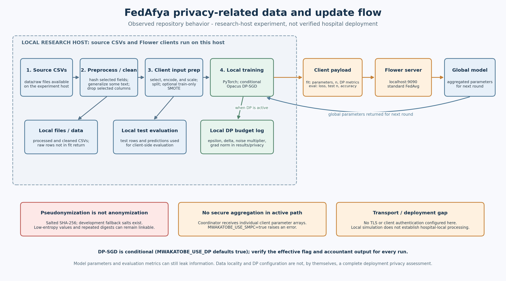
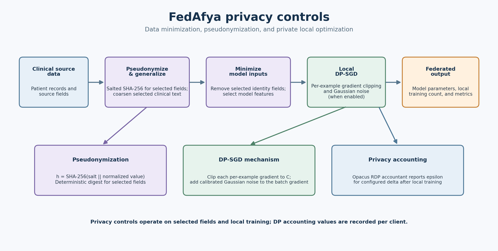
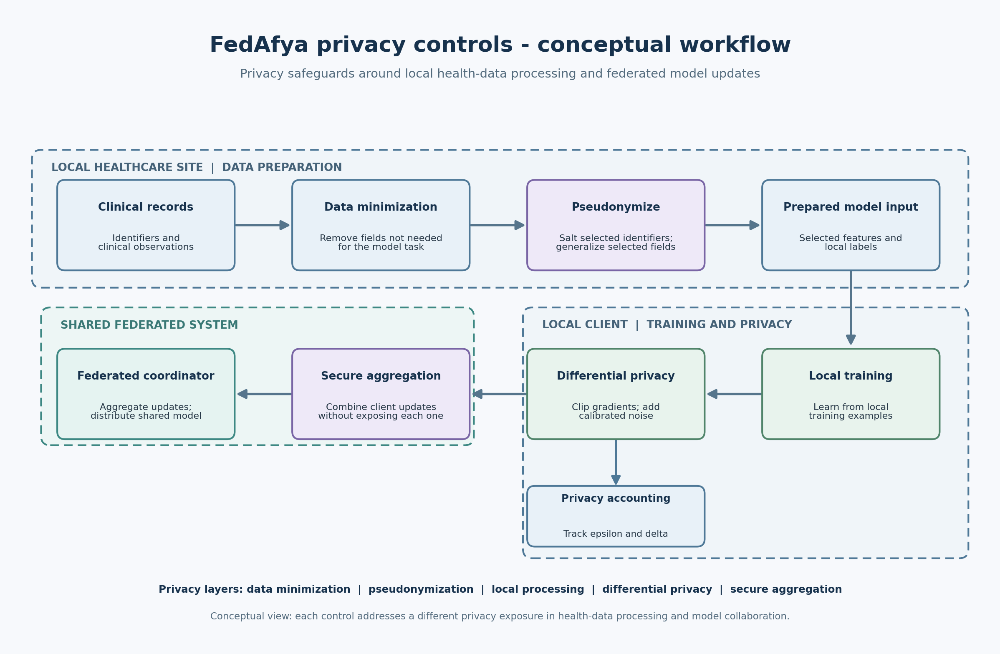

# FedAfya Privacy-Related Code and Controls

> **Code reference, not a privacy certification.** This document records privacy-related code present in the repository as inspected on 11 November 2026. It is intended for technical review and patent-drafting support. It does not establish that patient data are anonymous, that a formal privacy guarantee holds for every run, or that the prototype is safe for clinical deployment.
>
> Source code is the evidence for implementation statements below. Where this document and older project prose differ, verify the current source, runtime configuration, and experiment records before relying on either.

## Privacy flow diagram



**Figure note:** This diagram summarizes the inspected repository behavior. It distinguishes local file processing and DP accounting from client/server payloads, and calls out that the current localhost experiment does not establish physical hospital-local deployment, secure aggregation, or encrypted transport.

## Privacy controls diagram



## Privacy controls workflow



**Figure note:** This is a conceptual workflow, not a claim that every shown control is active in the current implementation. In particular, secure aggregation is not enabled in the inspected code.

## 1. Privacy-control inventory

| Control | Code location | Observed status | Important limitation |
|---|---|---|---|
| Salted SHA-256 pseudonyms | [`client/data_utils.py`](../client/data_utils.py) | Hashes selected identifiers and fields before writing processed CSVs | Static development defaults exist; hashing is not encryption or anonymisation |
| Clinical generalisation | [`client/data_utils.py`](../client/data_utils.py) | Procedures are reduced to `Recorded` / `Not recorded`; sponsor values are grouped | Medications and Region remain in the processed representation; generalisation is partial |
| Model-column minimisation | [`client/clean_app.py`](../client/clean_app.py) | Drops selected columns before writing cleaned CSVs | Exact Age and potentially detailed Medications remain model features |
| DP-SGD | [`client/client_app.py`](../client/client_app.py) | Opacus `PrivacyEngine` configured conditionally; epsilon/delta are written after training | Runtime flag and accounting assumptions must be verified per run |
| Federated client/server flow | [`main.py`](../main.py), [`client/client_app.py`](../client/client_app.py), [`server/server_app.py`](../server/server_app.py) | Client returns model parameters, a sample count, and metrics; active endpoint is localhost | Current orchestration is a research-host process, not proof of hospital-local deployment |
| Secure aggregation | [`client/client_app.py`](../client/client_app.py), [`server/server_app.py`](../server/server_app.py) | Not enabled; `MWAKATOBE_USE_SMPC=true` raises an error in the client | Coordinator may receive individual client parameter arrays |
| Secret and data exclusions from Git | [`.env.example`](../.env.example), [`.gitignore`](../.gitignore) | Example salt placeholders are provided; `.env`, local data folders, and CSV result files are ignored | Ignore rules do not protect files on disk or prevent accidental external sharing |
| TLS / authentication | No active implementation identified in inspected server/client paths | Not configured in the inspected localhost Flower setup | Required before network deployment |

## 2. Salt loading and salted hashing

### 2.1 Salt configuration

[`client/data_utils.py`](../client/data_utils.py) loads six salts from environment variables, but falls back to the same development placeholder if a variable is missing. It warns if a placeholder is in use.

```python
def _load_salts():
    """Load hashing salts from environment variables with fallback defaults."""
    salts = {
        'id': os.getenv('MWAKATOBE_SALT_ID', 'dev-salt-placeholder-do-not-use-in-production'),
        'name': os.getenv('MWAKATOBE_SALT_NAME', 'dev-salt-placeholder-do-not-use-in-production'),
        'region': os.getenv('MWAKATOBE_SALT_REGION', 'dev-salt-placeholder-do-not-use-in-production'),
        'district': os.getenv('MWAKATOBE_SALT_DISTRICT', 'dev-salt-placeholder-do-not-use-in-production'),
        'ward': os.getenv('MWAKATOBE_SALT_WARD', 'dev-salt-placeholder-do-not-use-in-production'),
        'diagnoses': os.getenv('MWAKATOBE_SALT_DIAGNOSES', 'dev-salt-placeholder-do-not-use-in-production'),
    }

    if any('dev-salt-placeholder' in v for v in salts.values()):
        warnings.warn(
            "⚠️  SECURITY WARNING: Using development salt placeholders. "
            "For production, set environment variables: MWAKATOBE_SALT_* "
            "with strong random values. Static salts provide only pseudonymisation, not anonymisation.",
            category=UserWarning
        )

    return salts

SALTS = _load_salts()
```

The tracked [`.env.example`](../.env.example) contains placeholder strings, not production keys:

```dotenv
MWAKATOBE_SALT_ID=replace-with-a-strong-random-secret
MWAKATOBE_SALT_NAME=replace-with-a-strong-random-secret
MWAKATOBE_SALT_REGION=replace-with-a-strong-random-secret
MWAKATOBE_SALT_DISTRICT=replace-with-a-strong-random-secret
MWAKATOBE_SALT_WARD=replace-with-a-strong-random-secret
MWAKATOBE_SALT_DIAGNOSES=replace-with-a-strong-random-secret
```

The repository's [.gitignore](../.gitignore) excludes `.env` and `.env.*` while allowing `.env.example`. The application code does not enforce that production secrets are present: if an environment variable is absent, `_load_salts()` accepts the development default and emits a warning.

### 2.2 Hash operation

```python
def safe_hash(value, salt_key='id'):
    if pd.isna(value) or str(value).strip() == '':
        return np.nan
    clean = str(value).strip()
    salt = SALTS.get(salt_key, "")
    return hashlib.sha256((salt + clean).encode('utf-8')).hexdigest()
```

For a non-empty value `x` and salt `s`, the operation is:

$$
h=\operatorname{SHA256}(s \mathbin{\|} \operatorname{strip}(x))
$$

This is deterministic salted hashing, not encryption and not a keyed HMAC. Equal values hashed with the same salt produce equal digests. Anyone with the salt can test candidate low-entropy values, and anyone observing repeated digests can link matching values. Treat the output as pseudonymous personal data unless a qualified assessment determines otherwise.

### 2.3 Fields hashed, generalized, and retained

In [`preprocess_single_file()`](../client/data_utils.py), the code hashes selected fields and transforms others:

```python
final_df["Id"] = (
    df[id_col].apply(safe_hash, args=('id',)) if id_col else np.nan
)
final_df["Name"] = (
    df[name_col].apply(safe_hash, args=('name',)) if name_col else np.nan
)
final_df["District"] = (
    df[district_col].apply(safe_hash, args=('district',))
    if district_col else np.nan
)
final_df["Ward"] = (
    df[ward_col].apply(safe_hash, args=('ward',))
    if ward_col else np.nan
)
final_df["Diagnoses"] = (
    df[diagnoses_col].apply(safe_hash, args=('diagnoses',))
    if diagnoses_col else "Not recorded"
)
final_df["Region"] = (
    df[region_col].fillna("Unknown") if region_col else "Unknown"
)
final_df["Procedures"] = (
    df[procedures_col].apply(generalize_clinical)
    if procedures_col else "Not recorded"
)
final_df["Medications"] = (
    df[medications_col].apply(keep_or_not_recorded)
    if medications_col else "Not recorded"
)
```

The helper for procedure generalisation is:

```python
def generalize_clinical(value):
    if pd.isna(value) or str(value).strip().lower() in [
        '', 'none', 'no', '-', 'null', 'not recorded'
    ]:
        return "Not recorded"
    return "Recorded"
```

`Region` is currently retained as text; a line that would hash it is commented out. Medication text is retained by `keep_or_not_recorded()` when it is present. These transformations therefore do not establish that the processed dataset is anonymous.

## 3. Identifier removal before model input

[`clean_all_data()`](../client/clean_app.py) drops selected fields before writing cleaned CSVs:

```python
columns_to_drop = [
    "Id", "Name", "Gender", "Date of birth",
    "Ward", "District", "Diagnoses"
]

df_clean = df.drop(
    columns=[col for col in columns_to_drop if col in df.columns],
    errors="ignore",
)
```

The model's selected feature list in [`load_data()`](../client/client_app.py) is:

```python
features = [
    "Age", "Sponsor", "Region", "Pulse", "Resp", "Temp",
    "Sys", "Dia", "Procedures", "Medications", "Age_bin"
]
df = df[features]
```

Consequences to account for in a privacy review:

- Exact `Age`, `Region`, and `Medications` may be present in the model input.
- `Age_bin` is created in cleaning, but exact `Age` is also selected for training.
- A feature can be identifying in combination with other fields even if direct identifiers are removed.
- The final feature pipeline does not select hashed `Id`, `Name`, `District`, `Ward`, or `Diagnoses`.
- `drop_duplicates(subset=['Id'])` runs during preprocessing before `Id` is dropped later; this uses the pseudonymous identifier for local deduplication.

The cleaner also computes vital-sign missingness flags after filling the values:

```python
df_clean[col] = df_clean[col].fillna(fill_val)
# ...
df_clean[f"{col}_was_missing"] = df_clean[col].isna()
```

Because this flag is computed after imputation, it does not preserve the original missingness for values that were filled. This is a data-quality/privacy documentation point, not a privacy guarantee.

## 4. Local processing and federated data flow

`main.py` calls preprocessing and cleaning on files in the local repository's `data/` directories, then passes cleaned CSV paths to client threads. The client connects to `127.0.0.1:9090`.

```python
preprocess_all_data()
clean_all_data()

cleaned_dir = Path("data/cleaned")
class_to_index = get_global_outcome_classes(cleaned_dir)
cleaned_csvs = sorted(
    p for p in cleaned_dir.glob("*.csv")
    if not p.name.endswith("_mapped.csv")
)

for csv in cleaned_csvs:
    t = threading.Thread(
        target=start_flower_client,
        args=(csv.as_posix(), class_to_index),
        daemon=True,
    )
    t.start()
```

The client entry point uses the localhost address:

```python
def start_flower_client(csv_path, class_to_index):
    fl.client.start_numpy_client(
        server_address="127.0.0.1:9090",
        client=FlowerHospitalClient(csv_path, class_to_index)
    )
```

This code demonstrates a local research workflow. It does not establish a deployed architecture in which each hospital runs an isolated client inside its own controlled environment. Do not describe the local multi-client experiment as proof that records never leave the physical hospitals.

### 4.1 Values returned from a client

```python
def get_parameters(self, config=None):
    return [v.cpu().numpy() for v in self.model.state_dict().values()]

# At the end of fit()
return self.get_parameters(), len(self.X_train), privacy_metrics
```

The client returns model parameter arrays, a training-array length, and privacy metrics. It does not return the raw feature rows in this return statement. However, model parameters and metrics can still leak information; data locality alone is not a formal privacy guarantee. The count is `len(self.X_train)`, which may include synthetic training examples if SMOTE is enabled.

### 4.2 Active server strategy

```python
class FederatedAveraging(fl.server.strategy.FedAvg):
    """Standard weighted FedAvg; secure aggregation is not enabled here."""

if __name__ == "__main__":
    fl.server.start_server(
        server_address="127.0.0.1:9090",
        config=fl.server.ServerConfig(num_rounds=10),
        strategy=FederatedAveraging(
            on_fit_config_fn=lambda server_round: {
                "server_round": server_round
            }
        ),
    )
```

The inspected server uses ordinary Flower FedAvg. It is not configured to cryptographically hide an individual client's update from the coordinator.

## 5. Differential privacy (Opacus DP-SGD)

### 5.1 Runtime settings

```python
def env_flag(name, default):
    value = os.getenv(name)
    return default if value is None else value.lower() in {
        "1", "true", "yes"
    }

USE_DP = env_flag("MWAKATOBE_USE_DP", True)
USE_SMPC = env_flag("MWAKATOBE_USE_SMPC", False)
USE_SMOTE = env_flag("MWAKATOBE_USE_SMOTE", True)

DP_NOISE_MULTIPLIER = float(
    os.getenv("MWAKATOBE_DP_NOISE_MULTIPLIER", "1.1")
)
DP_MAX_GRAD_NORM = float(
    os.getenv("MWAKATOBE_DP_MAX_GRAD_NORM", "1.0")
)
DP_DELTA = float(os.getenv("MWAKATOBE_DP_DELTA", "1e-5"))
DP_BATCH_SIZE = int(os.getenv("MWAKATOBE_DP_BATCH_SIZE", "256"))
DP_SIGMA = float(os.getenv("MWAKATOBE_DP_SIGMA", "0.002"))
```

`USE_DP` defaults to true when its environment variable is absent. Accepted true strings are `1`, `true`, and `yes` (case-insensitive); any other supplied string evaluates to false. The effective value must be recorded for each run.

`DP_SIGMA` is separately recorded in an experiment-result CSV. In the inspected `make_private()` call, the noise argument is `DP_NOISE_MULTIPLIER`; do not conflate the `DP_SIGMA` result label with the Opacus noise multiplier.

### 5.2 Opacus setup in the client

The data loader uses `DP_BATCH_SIZE` and the client conditionally wraps the model, optimizer, and loader:

```python
self.train_loader = DataLoader(
    TensorDataset(self.X_train, self.y_train),
    batch_size=min(DP_BATCH_SIZE, len(self.X_train)),
    shuffle=True,
)
self.privacy_engine = None

if USE_DP:
    self.privacy_engine = PrivacyEngine(accountant="rdp")
    self.model, self.optimizer, self.train_loader = (
        self.privacy_engine.make_private(
            module=self.model,
            optimizer=self.optimizer,
            data_loader=self.train_loader,
            noise_multiplier=DP_NOISE_MULTIPLIER,
            max_grad_norm=DP_MAX_GRAD_NORM,
        )
    )
```

The local training loop computes the loss, backpropagates, and calls the wrapped optimizer:

```python
for X_batch, y_batch in self.train_loader:
    self.optimizer.zero_grad()
    out = self.model(X_batch)
    loss = criterion(out, y_batch)
    loss.backward()
    self.optimizer.step()
```

Conceptually, DP-SGD clips each per-example gradient `g_i` to the norm bound `C` and adds Gaussian noise before updating. This is a conceptual description; the exact privacy guarantee is computed by Opacus' accountant under its mechanism and sampling assumptions:

$$
\bar{g}_i
=
g_i \min\left(1,\frac{C}{\lVert g_i\rVert_2}\right)
$$

$$
\widetilde{g}
=
\frac{1}{B}\left(
\sum_{i=1}^{B}\bar{g}_i
+
\mathcal{N}(0,\sigma^2 C^2 I)
\right)
$$

In these equations, `C` corresponds to the configured maximum gradient norm; the effective noise and sampling/accounting details must be taken from the actual Opacus configuration and runtime, not inferred solely from these conceptual equations.

### 5.3 Privacy accounting and output file

```python
privacy_metrics = {}
if self.privacy_engine is not None:
    epsilon = self.privacy_engine.get_epsilon(DP_DELTA)
    privacy_metrics = {
        "dp_epsilon": epsilon,
        "dp_delta": DP_DELTA,
    }
    privacy_dir = Path("results/privacy")
    privacy_dir.mkdir(parents=True, exist_ok=True)
    privacy_path = (
        privacy_dir / f"{self.hospital_name}_privacy_budget.csv"
    )
    pd.DataFrame([{
        "hospital": self.hospital_name,
        "round": round_num,
        "epsilon": epsilon,
        "delta": DP_DELTA,
        "noise_multiplier": DP_NOISE_MULTIPLIER,
        "max_grad_norm": DP_MAX_GRAD_NORM,
    }]).to_csv(
        privacy_path,
        mode="a",
        header=not privacy_path.exists(),
        index=False,
    )
```

An epsilon/delta value is meaningful only with its run configuration, accountant, sampling assumptions, number of steps/epochs, and threat model. The output path is a local result path; `.gitignore` ignores CSV files under `results/`. Verify actual files and their handling before publication or sharing.

## 6. Secure aggregation and transport status

The client currently fails closed if the SMPC flag is enabled:

```python
if USE_SMPC:
    raise RuntimeError(
        "MWAKATOBE_USE_SMPC is not supported by this legacy NumPyClient path. "
        "Configure Flower SecAgg/SecAgg+ before enabling secure aggregation."
    )
```

No Flower SecAgg/SecAgg+ strategy is configured in the inspected server code. Do not claim secure aggregation is implemented.

The active client/server address is `127.0.0.1:9090`; no TLS, certificate authentication, or remote authorization configuration was identified in the inspected active code. A localhost experiment is not evidence of encrypted/authenticated network transport in deployment.

## 7. Repository data and secret handling

The relevant [.gitignore](../.gitignore) rules are:

```gitignore
# Secrets and local configuration
.env
.env.*
!.env.example
*.pem
*.key

# Raw and locally generated healthcare data
data/raw/
data/processed/
data/cleaned/

# Experiment outputs may contain sensitive or large derived data.
results/*
!results/
!results/*/
!results/**/*.png
results/**/*.csv
*.pdf
```

These are Git tracking rules only. They do not encrypt or delete local files, restrict backups, prevent copying, or ensure that every generated figure is safe to publish. Review each artifact for small-cell disclosure, identifying labels, and inference risk before sharing.

## 8. Privacy limitations and review checklist

- [ ] Replace development salt defaults with distinct, high-entropy secrets for each deployment; use a protected secret store and restrict access.
- [ ] Consider keyed HMAC for deterministic pseudonyms and document key rotation/linkability requirements with the data owner.
- [ ] Review all processed and model-input columns, including exact age, region, medication text, outcomes, and rare combinations.
- [ ] Confirm missingness and structural-availability representations; the current vital-sign flags are calculated after imputation.
- [ ] Capture each run's effective DP flags and parameters, local epochs/steps, sampling policy, and Opacus accounting output.
- [ ] Verify which updates and metrics transit the network and whether any CSV rows, identifiers, or sensitive values appear in logs.
- [ ] Do not enable the SMPC flag as a substitute for implementing and testing a real secure-aggregation protocol.
- [ ] Add TLS, client authentication, authorization, and deployment isolation before exposing clients or servers beyond localhost.
- [ ] Review outputs and figures before publication; `.gitignore` is not a privacy control.
- [ ] Obtain institutional data-protection, ethics, and patent-counsel review before public disclosure or deployment.

## 9. Source files

- [Salt loading, hashing, and preprocessing](../client/data_utils.py)
- [Cleaning, dropping selected fields, and imputation](../client/clean_app.py)
- [DP configuration, client training, accounting, and client return values](../client/client_app.py)
- [Experiment orchestration](../main.py)
- [Active Flower server](../server/server_app.py)
- [Example salt-variable names](../.env.example)
- [Git ignore rules for local data, secrets, and result files](../.gitignore)
- [Project README privacy discussion](../README.md)
